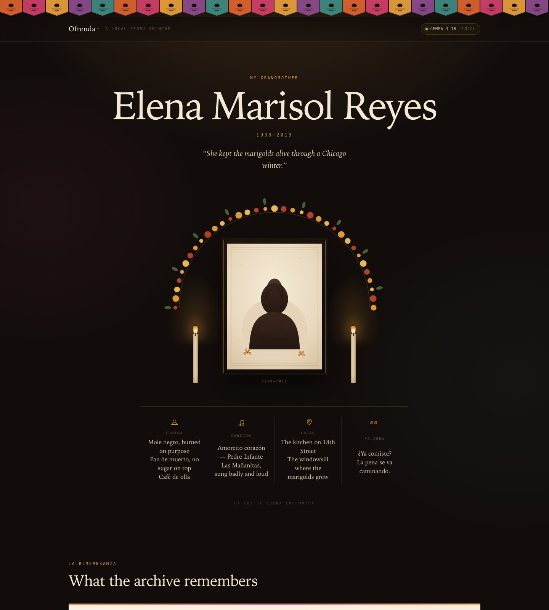

# Ofrenda

**The people you carry, kept in their own words.**

Ofrenda is a local-first remembrance archive for Día de los Muertos. You write
down the small, specific things about someone — the mole she burned on purpose,
the song she sang into an iron, the phrase she used when you were crying. A
local open-weight **Gemma** model writes a short remembrance from those notes
and answers questions about the person using *only* what you wrote, citing the
memories it used.

No account. No upload. No vector database. The archive is a folder of Markdown
and JSON that opens in any text editor, and the whole thing runs with the
network unplugged.

> Built for [Hacktoberfest 2026, Week 4: Ghost in the Machine](https://dev.to/challenges/hacktoberfest-week4-2026-10-26).
> The demo altar is entirely fictional.

**Live demo:** https://ofrenda-obes.onrender.com/p/elena — the public room runs in
candlelight mode (no model call), so it can only quote the archive.



## Why this exists

Most "AI memorial" products ask you to upload a dead person's messages to
someone else's server and then generate a chatbot that sounds like them. That is
the wrong shape for grief. It is also a privacy disaster: the stories of people
who cannot consent to being in a training pipeline are the most sensitive data a
family has.

Ofrenda takes the opposite position:

- **The archive belongs to the family.** `data/people/<slug>/` is plain files.
  Back it up, print it, put it on a USB stick, delete it.
- **The model is a reader, not a medium.** It is explicitly instructed never to
  impersonate the person who died, never to predict what they would want, and
  never to invent a detail. A model answer without a citation is thrown away and
  replaced with a direct quotation from the archive.
- **The lights can be off.** With no model running, the altar still renders and
  the archive still answers by quoting itself ("candlelight mode"). Gemma adds
  synthesis, not access.
- **It will be readable in twenty years.** Markdown, JSON, one `npm` dependency
  count of zero, and a static export that is one HTML file plus a stylesheet.

## Run it

You need **Node 22+** and **[Ollama](https://ollama.com)**.

```bash
ollama pull gemma3:4b      # ~3.3 GB; use gemma3:1b (~800 MB) on a small laptop
npm run seed               # copy the fictional demo altar into ./data
npm start
```

Open <http://localhost:3000/p/elena>. Press "Ask the archive" to talk to it, or
"Write it again" to regenerate the remembrance.

Nothing is installed from npm. There is no build step. `npm test` runs 24 tests
with no model and no network.

## The archive is a folder

```
data/people/elena/
├── profile.json
└── memories/
    ├── seeds-1961.md
    ├── blackout-1994.md
    └── ...
```

```md
---
id: blackout-1994
title: The blackout, and the mole
year: 1994
people: [Elena, me, my mother]
---
The whole block lost power for eleven hours in July. She went inside and cooked
mole negro on the gas burner by candlelight...
```

```json
{
  "name": "Elena Marisol Reyes",
  "born": "1938",
  "died": "2019",
  "relationship": "my grandmother",
  "offerings": {
    "foods": ["Mole negro, burned on purpose"],
    "songs": ["Amorcito corazón — Pedro Infante"],
    "places": ["The kitchen on 18th Street"]
  }
}
```

The CLI writes the same files the web app reads:

```bash
ofrenda new "Rosa Ibarra" --born 1940 --died 2020 --relationship "my aunt"
ofrenda add rosa-ibarra --title "The kettle" --year 1998 --body "..."
ofrenda write rosa-ibarra
ofrenda ask rosa-ibarra "What did she do when it snowed?"
ofrenda export rosa-ibarra dist/rosa     # static keepsake, opens offline
ofrenda status                           # is Ollama up? is the model pulled?
```

## How it works

```
memory files ──► retrieve.js ──► prompt ──► Gemma 3 (Ollama) ──► validation ──► answer + cites
                     │                                            │
                     └──────── candlelight mode ──────────────────┘
```

1. **Retrieval is deliberately boring.** `src/retrieve.js` scores memories with
   an IDF-weighted lexical match, accent-folded and lightly stemmed for English
   and Spanish, and drops filler ("ever", "talk about") so an unrelated question
   does not ride a common word into a wrong quote. No embeddings, no database, no
   service. It runs in microseconds and you can explain every result.
2. **The prompt is a contract.** `prompts/spirit.md` tells the model it is the
   reader of an archive, not the person in it; answer only from the memories,
   in under 90 words, and name the exact titles it used.
3. **Validation is where the trust lives.** `src/spirit.js` throws away any
   citation that is not an exact title in the archive. If the model claims to be
   grounded but cites nothing, its answer is discarded and the archive quotes
   itself instead. Remembrances under 150 words, over 300 words, written in the
   keeper's first person, or without a source are rejected the same way.
4. **Candlelight mode is a first-class path.** If Ollama is unreachable, the app
   does not break and does not fake it: it selects the most relevant sentences
   and quotes them, marked "partially grounded".
5. **The keepsake export** re-renders the same page as static HTML with the
   stylesheet and portrait, so an altar can be printed or archived without Node.

## Gemma, specifically

The app targets **Gemma 3** through Ollama (`gemma3:4b` by default,
`gemma3:1b` for laptops). It is a plain Ollama `/api/chat` call with a JSON
schema in `format` (Ollama's structured outputs), so the model has to return
the shape the validator expects. Any open-weight model Ollama can run works:

```bash
OFRENDA_MODEL=gemma3:1b npm start     # smaller, faster, rougher
OFRENDA_MODEL=llama3.2:3b npm start   # swap the model, same archive
```

Smaller models are noticeably worse at obeying the "do not invent" contract.
The validation layer exists because of that: the app is designed to fail
closed — a bad model produces a quoted archive answer, never a confident
hallucination.

## Render

The public reading room is a Render web service defined in
[`render.yaml`](render.yaml). It seeds the demo altar at build time and runs in
candlelight mode so the demo costs almost nothing and cannot invent anything:

[](https://render.com/deploy?repo=https://github.com/BhushanVidhate-27/ofrenda)

To let Gemma answer on Render, point `OLLAMA_URL` at an Ollama instance you
control (a GPU Droplet, or a tunnel to your own machine) and set
`OFRENDA_INFERENCE=local`. The free Render instance has ephemeral storage; the
real archive is meant to live on your laptop. On a paid instance, mount a
persistent disk at `/var/data` and set `OFRENDA_DATA_DIR=/var/data` so new
memories survive deploys.

## What it will not do

- It will not speak as the dead person, or tell you what they would think.
- It will not answer from general knowledge. If the archive does not hold it,
  it says so and suggests the kind of memory that would fill the gap.
- It will not upload anything. There is no analytics, no telemetry, no external
  font, no CDN. The CSP in `src/server.js` allows `self` and `data:` images only.
- It will not pretend to be secure for a public multi-user deployment. There is
  no auth: run it on localhost, or put it behind an authenticating proxy if you
  expose it. The design assumption is one family, one machine.

## Development

```bash
npm test                 # 24 tests, no model required
npm run dev              # restart on change
npm run export           # dist/elena, a static altar
npm start                # http://localhost:3000
```

```
src/server.js     dependency-free HTTP server, routes, CSP
src/store.js      Markdown + JSON persistence, seed/export
src/retrieve.js   lexical retrieval (IDF + light stemming)
src/spirit.js     prompts, validation, candlelight fallback
src/render.js     server-rendered altar, landing, forms
public/           stylesheet, small progressive-enhancement script
prompts/          the two contracts given to the model
examples/elena/   fictional demo archive
```

The demo person, her family, and every memory in `examples/elena` are invented.
If you build your own altar, start with one true, boring, specific detail. It
works better than a biography.

## License

MIT.
